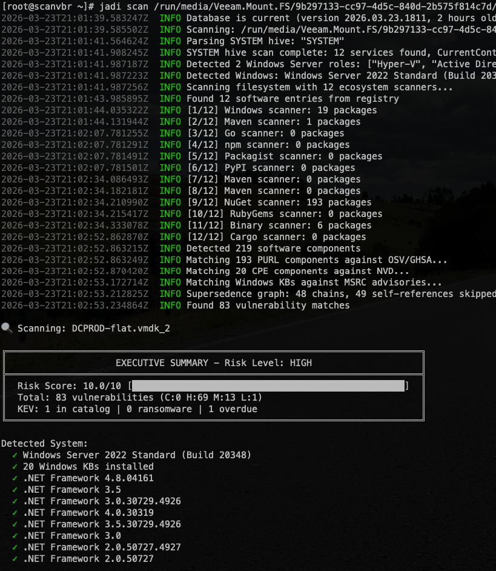
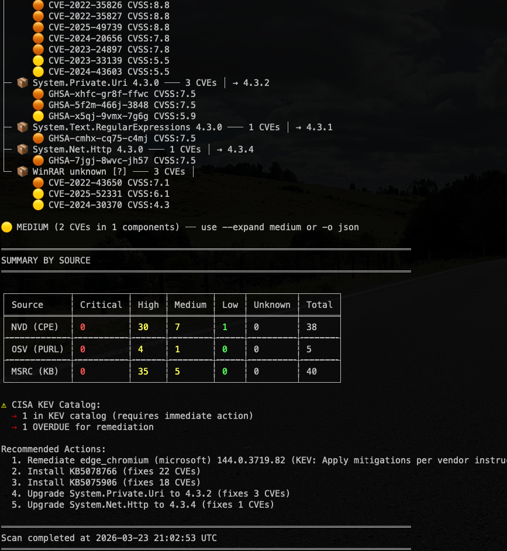

# Jadi Scanner

**Offline vulnerability scanner for mounted Windows backups and live filesystems**

[](https://github.com/mescobarcl/jadi/releases)
[](LICENSE)
[](https://github.com/mescobarcl/jadi/releases)

Jadi analyzes mounted backup filesystems and live systems to detect installed software, correlate it against 12 vulnerability and threat-intelligence sources, and generate compliance-ready reports and SBOMs. Built for IT security teams, MSPs, and backup administrators who need to assess the security posture of Windows servers and workstations before or after restoration, without booting them.

## Key Features

- **Windows offline analysis**: registry hive parsing, patch state from the installed build and UBR (validated against Windows Update), Monthly Rollups, MSRC matching, .NET Framework and .NET runtimes, SQL Server, Microsoft 365 Apps / Office Click-to-Run, Edge, Visual Studio and Store apps, server role filtering
- **Vulnerable drivers (BYOVD)**: every kernel driver hashed and checked against loldrivers.io and Microsoft's vulnerable driver blocklist
- **Exploitation intelligence**: CISA KEV, EPSS, CISA SSVC and Microsoft's exploitation status on every finding
- **End of support**: unsupported Windows, SQL Server, Exchange, Office and .NET releases reported as findings
- **12 ecosystem scanners**: npm, PyPI, Maven, Gradle, Go, NuGet, Composer, RubyGems, Cargo, .NET, JAR, and binary detection
- **12 data sources**: 699,000+ vulnerabilities, rebuilt and signed daily
- **Complete SBOM and re-matching**: CycloneDX with OS, KBs, drivers and stable purls; re-match a stored SBOM against today's data with `jadi match`, no backup needed
- **Authenticated database**: SHA-256 plus a mandatory ed25519 signature over the whole update manifest
- **7 output formats**: Table, JSON (Trivy-compatible), SARIF, CSV, Markdown, SPDX, CycloneDX
- **CI/CD ready**: SARIF output, severity-based exit codes, suppression rules
- **Offline capable**: scan air-gapped systems with `--offline` or `JADI_OFFLINE=1`

## Quick Start

```bash
# Install (Linux x86_64)
curl -LO https://github.com/mescobarcl/jadi/releases/latest/download/jadi-linux-x86_64
curl -LO https://github.com/mescobarcl/jadi/releases/latest/download/jadi-linux-x86_64.sha256
sha256sum -c jadi-linux-x86_64.sha256
chmod +x jadi-linux-x86_64 && sudo mv jadi-linux-x86_64 /usr/local/bin/jadi

# Download vulnerability database
jadi update-db

# Scan a mounted backup
jadi scan /mnt/backup

# JSON report plus CycloneDX SBOM in one pass
jadi scan /mnt/backup -o json -f jadi-report.json --sbom-file sbom.cdx.json
```

## Sample Output (Windows Server 2022, Real Scan)

A Windows Server 2022 backup two years behind on updates, scanned with `--expand none`:

```
╔════════════════════════════════════════════════════════════════════════════╗
║                  EXECUTIVE SUMMARY - Risk Level: CRITICAL                  ║
╠════════════════════════════════════════════════════════════════════════════╣
║  Risk Score: 10.0/10 [██████████████████████████████████████████████████]  ║
║  Total: 5032 vulnerabilities (C:221 H:3537 M:1243 L:31)                    ║
║  KEV: 49 in catalog | 3 ransomware | 47 overdue                            ║
╚════════════════════════════════════════════════════════════════════════════╝

Detected System:
  ✓ Windows Server 2022 Standard (Build 20348.2582)
  ✓ 2 Windows KBs installed
  ✓ .NET Framework 4.8+ (528449)

Detected 6 software components

⚠ Scan notices:
  → 22 low-confidence matches hidden (NVD entries without a version range); use --show-low-confidence to include them

VULNERABILITIES BY COMPONENT (5032 CVEs in 5 components)

🔴 CRITICAL (4981 CVEs in 3 components)
├─ 📦 Windows Server 2022 Standard Build 20348.2582 ─── 4183 CVEs │ 47 KEV → KB5041160
├─ 📦 Microsoft Edge 155.0.4283.60 ─── 707 CVEs │ 1 KEV → >=156.0.4314.80
└─ 📦 Google Chrome 157.0.8103.40 ─── 91 CVEs │ 1 KEV → >=157.0.8103.50

🟠 HIGH (51 CVEs in 2 components)
├─ 📦 .NET Framework on Windows S... .NET Framework 4.8+ (528449) ─── 50 CVEs │ → KB5044099
└─ 📦 VMware Tools 12.4.0.23259341 ─── 1 CVEs │ → >=12.5.4

SUMMARY BY SOURCE
┌──────────────────────┬──────────┬──────┬────────┬─────┬─────────┬───────┐
│ Source               ┆ Critical ┆ High ┆ Medium ┆ Low ┆ Unknown ┆ Total │
╞══════════════════════╪══════════╪══════╪════════╪═════╪═════════╪═══════╡
│ NVD (CPE)            ┆ 8        ┆ 57   ┆ 19     ┆ 11  ┆ 0       ┆ 95    │
│ MSRC (KB)            ┆ 213      ┆ 3480 ┆ 1224   ┆ 20  ┆ 0       ┆ 4937  │
└──────────────────────┴──────────┴──────┴────────┴─────┴─────────┴───────┘

⚠ CISA KEV Catalog:
  → 49 in KEV catalog (requires immediate action)
  → 3 associated with ransomware campaigns
  → 47 OVERDUE for remediation
```

> Components marked with `[?]` have low detection confidence (version unknown from filesystem detection).

## Windows & Microsoft Analysis

Jadi is designed to scan Windows systems offline: mount a backup image and analyze it from Linux without booting Windows. This is a key differentiator over scanners that require a running OS.

### What Jadi detects on Windows backups

| Capability | Description |
|------------|-------------|
| **Installed software** | `SOFTWARE` and every profile's `NTUSER.DAT`, MSI registrations, portable and per-user apps (`AppData`, `Desktop`, `Downloads`), versions from the executable's version resource |
| **Patch state** | Decides per CVE from the installed build and UBR, the Patch Tuesday it contains and the fixed build of that exact release; installed KBs and Monthly Rollups for older Windows. Only updates in state Installed count |
| **Windows releases** | Server 2003 to Server 2025 and Windows 7 to Windows 11 26H2, each matched with its own MSRC rows |
| **Microsoft 365 Apps / Office** | Click-to-Run build checked against the fixed build of its update channel; out-of-support version lines flagged |
| **SQL Server 2016 to 2025** | Matched by build against Microsoft's fixed build for its servicing track (GDR or CU), with the KB to install |
| **.NET** | .NET Framework versions from the registry, plus every .NET, ASP.NET Core and Desktop runtime; NuGet packages from `*.deps.json` and `*.csproj` |
| **Edge, Visual Studio, Store apps** | Matched against Microsoft's fixes shipped without a KB |
| **Kernel drivers** | Every `.sys` in `System32\drivers` and the driver store, hashed (SHA-256 and Authenticode) and checked against loldrivers.io and Microsoft's vulnerable driver blocklist |
| **End of support** | `EOL-<product>-<release>` findings for unsupported Windows, SQL Server, Exchange, Office and .NET |
| **Server role filtering** | IIS, DNS, DHCP, Hyper-V, Active Directory and more: only CVEs relevant to installed roles and enabled services |
| **Hot backups** | Registry transaction logs (`.LOG1`/`.LOG2`) are replayed, so VSS and crash-consistent backups show current data |
| **Unreadable files** | Files the mount cannot read (e.g. system-compressed files on ntfs-3g without its plugin) are counted and reported, not silently skipped |

### Example: Scan a Windows backup

```bash
# Mount a Windows backup image
sudo mount -o ro /dev/sdb1 /mnt/windows-backup

# Scan with Windows noise filtering
jadi scan /mnt/windows-backup --skip-windows-noise

# Only show actively exploited vulnerabilities
jadi scan /mnt/windows-backup --kev-only --skip-windows-noise

# Generate compliance report
jadi scan /mnt/windows-backup -o markdown -f windows-audit.md --skip-windows-noise
```

## Installation

```bash
# Download binary and checksum
curl -LO https://github.com/mescobarcl/jadi/releases/latest/download/jadi-linux-x86_64
curl -LO https://github.com/mescobarcl/jadi/releases/latest/download/jadi-linux-x86_64.sha256

# Verify integrity
sha256sum -c jadi-linux-x86_64.sha256

# Install
chmod +x jadi-linux-x86_64
sudo mv jadi-linux-x86_64 /usr/local/bin/jadi

# Verify
jadi --version
```

### Requirements

| Requirement | Details |
|-------------|---------|
| **OS** | Ubuntu 24.04+ / Debian 13+ / any Linux x86_64 with glibc 2.39+ |
| **Disk** | ~14 MB binary + ~1.8 GB vulnerability database (~300 MB download) |
| **Memory** | ~100 MB typical, ~500 MB for large scans |
| **Network** | Required for `update-db`; `--offline` for air-gapped use |

## Commands

### `update-db`: Download vulnerability database

```bash
jadi update-db          # Update if a new version is available
jadi update-db --force  # Force re-download
```

The database is rebuilt and signed daily and distributed via CDN (~300 MB compressed).

### `db-status`: Check database info

```bash
$ jadi db-status

Vulnerability Database Status
------------------------------
Version:     2026.11.16.1401
Location:    jadi.db
Size:        1733.2 MB
Age:         0 hours

Database Contents:
  KEV entries: 1781
  Ransomware-associated: 361
  Total vulnerabilities: 699239

Exploitation, drivers and end of support:
  EPSS: 406741
  CISA SSVC: 219336
  MSRC exploitation: 14760
  Driver blocklist: 572
  End of support: 140
```

### `scan`: Scan for vulnerabilities

```bash
jadi scan /mnt/backup                                    # Basic scan
jadi scan /mnt/backup -o json -f jadi-report.json        # JSON report
jadi scan /mnt/backup --sbom-file sbom.cdx.json          # Also write the CycloneDX SBOM (same walk)
jadi scan /mnt/backup --min-severity high                # Filter by severity
jadi scan /mnt/backup --kev-only                         # Only actively exploited (CISA KEV)
jadi scan /mnt/backup --ransomware-only                  # Only ransomware-associated
jadi scan /mnt/backup -o sarif -f results.sarif          # SARIF for GitHub Security
jadi scan /mnt/backup -o spdx -f sbom.spdx.json          # SBOM (SPDX)
jadi scan /mnt/backup -o cyclonedx -f sbom.cdx.json      # SBOM (CycloneDX)
jadi scan /mnt/backup --fail-on-severity high            # CI mode: exit 2 if high+
jadi scan /mnt/backup --expand all                       # Show all vulnerability details
```

### `match`: Re-match a saved inventory

Re-check a stored inventory against today's database, without the backup. Windows (build, KBs, drivers, roles) is re-matched too.

```bash
jadi match --sbom sbom.cdx.json                          # CycloneDX SBOM from scan
jadi match --sbom jadi-report.json -o json               # A previous `scan -o json` report
jadi match --sbom inventory.json --fail-on-severity high # Inventory from list-software
```

Same filters, formats, suppressions and exit codes as `scan`.

### `list-software`: Software inventory

```bash
jadi list-software /mnt/backup
jadi list-software /mnt/backup --show-paths
jadi list-software /mnt/backup -o json --inventory -f inventory.json   # Re-matchable inventory, no database needed
```

## Scan Options

| Option | Description | Default |
|--------|-------------|---------|
| `-o, --output` | Format: table, json, sarif, csv, markdown, spdx, cyclonedx | `table` |
| `-f, --output-file` | Save output to file | stdout |
| `--sbom-file` | Also write the CycloneDX SBOM of the same scan | none |
| `--min-severity` | Minimum: critical, high, medium, low | `low` |
| `--hide-unknown` | Also hide findings without a severity score | off |
| `--show-low-confidence` | Include NVD matches that claim every version with no range | off |
| `--only-ecosystem` | Single ecosystem (npm, maven, etc.) | all |
| `--exclude-path` | Exclude paths (repeatable) | none |
| `--max-depth` | Directory depth (1-100) | `15` |
| `--threads` | Scanning threads (1-128) | auto |
| `--kev-only` | Only CISA KEV vulnerabilities | off |
| `--ransomware-only` | Only ransomware-associated CVEs | off |
| `--skip-windows-noise` | Skip WinSxS, Temp, Installer | off |
| `--offline` | Skip database update check | off |
| `--parallel-match` | Parallel database queries | off |
| `--show-suppressed` | Include suppressed findings, marked with reason and approver | off |
| `--ignore-suppressions` | Audit mode: disable all suppressions | off |
| `--fail-on-severity` | Exit 2 if findings at/above severity | none |
| `--expand` | Detail level: critical,high,medium,low,all,none | critical,high |

Global options (`-d/--database`, `-c/--config`, `-v`, `-q`) work before or after the subcommand. With `-q`, stdout carries only the result.

### Environment Variables

| Variable | Effect |
|----------|--------|
| `JADI_DB` | Database path (instead of `-d`) |
| `JADI_OFFLINE=1` | Never contact the CDN, like `--offline` |
| `JADI_DB_URL` | HTTPS mirror for database downloads. It must serve `latest.json` unmodified |
| `JADI_ALLOW_UNSIGNED=1` | Development mirrors only: accept a manifest without a signature, with a warning |

## Database Integrity

Every update must carry a valid **ed25519 signature** over the whole manifest (version, file, sizes, release time and SHA-256), verified against a public key embedded in the binary. An unsigned or invalidly signed database is refused, versions are compared numerically (a forged version cannot freeze updates), and the downloaded and decompressed sizes must match the signed manifest exactly. The database is opened read-only, and Jadi warns when it is older than the recommended age.

## Output Formats

| Format | Flag | Use Case |
|--------|------|----------|
| Table | `-o table` | Human-readable terminal output |
| JSON | `-o json` | Integration, automation (Trivy-compatible) |
| SARIF | `-o sarif` | GitHub/Azure security integration |
| CSV | `-o csv` | Spreadsheet analysis, SIEM import |
| Markdown | `-o markdown` | Documentation, compliance reports |
| SPDX | `-o spdx` | SBOM compliance (ISO/IEC 5962:2021) |
| CycloneDX | `-o cyclonedx` | Full inventory SBOM (OS, KBs, drivers, purls) with vulnerabilities |

### JSON Format

The JSON output structure (abridged, from the sample scan above):

```json
{
  "summary": {
    "total_vulnerabilities": 5032,
    "by_severity": { "critical": 221, "high": 3537, "medium": 1243, "low": 31, "unknown": 0 },
    "kev": { "in_catalog": 49, "ransomware_associated": 3, "overdue": 47 }
  },
  "windows_info": { "product_name": "Windows Server 2022 Standard", "current_build": "20348", "ubr": 2582 },
  "Results": [
    {
      "Vulnerabilities": [
        {
          "VulnerabilityID": "CVE-2024-38063",
          "Title": "Windows TCP/IP Remote Code Execution Vulnerability",
          "Severity": "CRITICAL",
          "CvssScore": 9.8,
          "CvssVector": "CVSS:3.1/AV:N/AC:L/PR:N/UI:N/S:U/C:H/I:H/A:H",
          "CweIDs": ["CWE-191"],
          "Source": "Msrc",
          "Confidence": "High",
          "PkgName": "Windows Server 2022 Standard",
          "InstalledVersion": "Build 20348.2582",
          "FixedVersion": "KB5041160",
          "References": ["https://msrc.microsoft.com/update-guide/vulnerability/CVE-2024-38063"],
          "KEV": { "in_catalog": false, "known_ransomware": false },
          "Exploitation": {
            "msrc_exploited": false,
            "msrc_exploitability": "Exploitation More Likely",
            "ssvc_exploitation": "poc",
            "ssvc_automatable": true,
            "ssvc_technical_impact": "total",
            "epss": 0.73572,
            "epss_percentile": 0.99475
          }
        }
      ]
    }
  ]
}
```

`windows_info` is present for Windows scans. When a vulnerability has other ids (for example the GHSA of a CVE), they are listed in `VendorIDs`.

## Supported Ecosystems

| Ecosystem | Detection Files |
|-----------|-----------------|
| npm | `package-lock.json`, `yarn.lock`, `pnpm-lock.yaml` |
| PyPI | `requirements.txt`, `Pipfile.lock`, `poetry.lock` |
| Maven | `pom.xml` |
| Gradle | `build.gradle`, `build.gradle.kts` |
| Go | `go.mod`, `go.sum` |
| .NET / NuGet | `*.deps.json` (.NET Core/5+), `packages.config` (legacy), `*.csproj` (PackageReference) |
| Composer | `composer.lock` |
| RubyGems | `Gemfile.lock` |
| Cargo | `Cargo.lock` |
| Windows | `SOFTWARE`, `SYSTEM` and `NTUSER.DAT` hives, kernel drivers, Store app packages |
| JAR | `META-INF/MANIFEST.MF`, `pom.properties` |
| Binary | Version resources of executables in Program Files, ProgramData, PortableApps and user profiles |

## Vulnerability Sources

| Source | Coverage | Description |
|--------|----------|-------------|
| **NVD** | 384,000+ CVEs | NIST National Vulnerability Database, every year since 1999 |
| **OSV** | 289,000+ advisories | Open Source Vulnerabilities (8 ecosystems) |
| **GHSA** | GitHub advisories | GitHub Security Advisories, linked to their CVEs |
| **MSRC** | Every Patch Tuesday since 2016 | Microsoft Security Response Center, with fixed builds per release |
| **MSRC app fixes** | 10,800+ fixes | Edge, Visual Studio, .NET, Teams and Store apps (fixes without a KB) |
| **CISA KEV** | 1,781 CVEs | Known Exploited Vulnerabilities catalog, with ransomware association |
| **EPSS** | 406,000+ CVEs | Exploit Prediction Scoring System (FIRST) |
| **CISA Vulnrichment** | 219,000+ CVEs | SSVC exploitation, automatable and technical impact |
| **MSRC exploitation** | 14,700+ entries | Exploited, Publicly Disclosed and Exploitability Index |
| **Office release notes** | Since November 2018 | Fixed builds of Microsoft 365 Apps / Office Click-to-Run per channel |
| **loldrivers.io** | 654 drivers | Vulnerable and malicious drivers |
| **Driver blocklist** | 572 rules | Microsoft's vulnerable driver blocklist |
| **endoflife.date** | 140 releases | End of support for Microsoft products |

**Total: 699,000+ vulnerabilities.** Database rebuilt and signed daily.

## Configuration

Jadi supports TOML configuration. Loads from: `.jadi.toml` (current dir) > `~/.config/jadi/config.toml` > `~/.jadi.toml`. The loaded file and the number of active suppressions are logged.

### Vulnerability Suppressions

```toml
[[suppress]]
cve = "CVE-2023-12345"
reason = "False positive: component not reachable"
expires = "2026-12-31"

[[suppress]]
package = "lodash"
reason = "Accepted risk: internal tool only"
expires = "2026-06-30"

[[suppress]]
path = "test/**/*"
reason = "Test fixtures: not deployed"
```

Audit mode (disable all suppressions): `jadi scan /mnt/backup --ignore-suppressions`

## Screenshots

Scanning a Windows Server 2022 backup (mounted VMDK from Veeam):





## Support & Contributing

- **Issues & Bug Reports**: [github.com/mescobarcl/jadi/issues](https://github.com/mescobarcl/jadi/issues)
- **Feature Requests**: Open an issue with the `enhancement` label
- **Questions**: Open an issue with the `question` label

We welcome feedback, bug reports, and feature suggestions from the community.

## License

MIT: see [LICENSE](LICENSE) for details.
